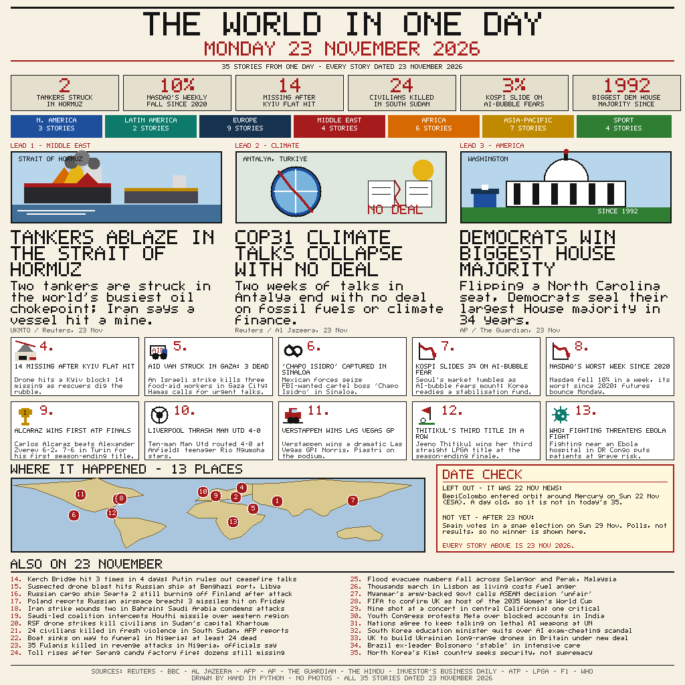

# THE WORLD IN ONE DAY — Monday 23 November 2026

Built for the [news-image bounty on make.fun](https://make.fun/bounty/news-image-20261123?ref=bp35q4sh).

One dense newspaper front page that sums up the world's news of
**Monday 23 November 2026**. 35 stories, every one of them dated
23 November 2026 (it happened, or was first reported, on that day).
Three lead stories with large drawn illustrations, ten more stories
with small pictograms, a numbered world map, a strip of six big numbers,
a region bar, a 22-item "also on" list, and a date-check box that names
one thing left out (22 Nov news) and one thing not yet happened.

## How it was built

`main.py` runs the renderer in `main_src.py` and writes the PNG to
`/output/entry.png` (falling back to `./output/entry.png`).
Standard library only — no network, no clock, no randomness — so two
runs write byte-identical files.

`main_src.py` is a small rasterizer written from scratch in this
session: an embedded 5x7 bitmap font, shape primitives (rect, line,
circle, polygon fill), the news data, three drawn lead illustrations
(tankers burning in Hormuz, a cracked globe with torn deal paper for
COP31, the US Capitol with a ballot box), nine pictograms, a simplified
world map with 13 numbered markers, and a minimal PNG encoder (zlib).

Verified in-session:

- `python3 main.py` run twice: identical sha256
  `6fdfc1277af76ac1f09a2552c32d7cf65d20dece891bc8c9b68653865f89862e`
  (41,564 bytes, 1024x1024).
- Same result under the grader's `python3 -P -s main.py` (the script
  puts its own directory on `sys.path` before importing `main_src`).
- The program refuses to finish if any text runs past its box; all
  35 stories and the date-check box were checked and the image was
  viewed by eye: no overflow, no overlap, no unreadable area.

## The 35 stories

| # | Story | Source, 23 Nov 2026 |
|---|-------|---------------------|
| 1 | Two tankers struck in the Strait of Hormuz; Iran says a vessel hit a mine | UKMTO / Reuters |
| 2 | COP31 climate talks in Antalya collapse with no deal on fossil fuels or finance | Reuters / Al Jazeera |
| 3 | Democrats win their largest House majority since 1992, flipping a North Carolina seat | AP / The Guardian |
| 4 | 14 missing after a Russian drone hits a residential block in the Kyiv region | BBC |
| 5 | Israeli strike kills three food-aid workers in a van in Gaza City | Al Jazeera |
| 6 | Mexican forces capture FBI-wanted cartel boss "Chapo Isidro" in Sinaloa | AFP |
| 7 | South Korea's Kospi slides 3% as AI-bubble fears mount | Al Jazeera |
| 8 | Nasdaq's 10% weekly fall, its worst since 2020; futures bounce on Monday | Reuters / Investor's Business Daily |
| 9 | Carlos Alcaraz beats Alexander Zverev 6-2, 7-6 to win his first ATP Finals | ATP / Daily Star |
| 10 | Liverpool thrash ten-man Manchester United 4-0 at Anfield | BBC Sport |
| 11 | Max Verstappen wins a dramatic Las Vegas Grand Prix | F1 |
| 12 | Jeeno Thitikul wins her third straight LPGA title at the season finale | LPGA |
| 13 | WHO: fighting near an Ebola hospital in DR Congo puts patients at grave risk | WHO / Al Jazeera |
| 14 | Kerch Bridge hit 3 times in 4 days; Putin rules out ceasefire talks | AP / PBS NewsHour |
| 15 | Suspected drone blast hits a Russian ship at Benghazi port, Libya | Reuters |
| 16 | Russian cargo ship Sparta 2 still burning off Finland after attack | Jagran Josh |
| 17 | Poland reports a Russian airspace breach; 3 missiles hit on Friday | AFP |
| 18 | Iran strike wounds two in Bahrain; Saudi Arabia condemns the attacks | AFP |
| 19 | Saudi-led coalition intercepts a Houthi missile over the western region | AFP |
| 20 | RSF drone strikes kill civilians in Sudan's capital Khartoum | AFP |
| 21 | 24 civilians killed in fresh violence in South Sudan | AFP |
| 22 | Boat sinks on the way to a funeral in Nigeria; at least 24 dead | Al Jazeera |
| 23 | 35 Fulanis killed in revenge attacks in Nigeria | AFP |
| 24 | Toll rises after the Serang candy factory fire; dozens still missing | Anadolu Agency / Jagran Josh |
| 25 | Flood evacuee numbers fall across Selangor and Perak, Malaysia | MalaysiaNow |
| 26 | Thousands march in Lisbon as living costs fuel anger | Jagran Josh |
| 27 | Myanmar's army-backed government calls an ASEAN decision "unfair" | Jagran Josh |
| 28 | FIFA to confirm the UK as host of the 2035 Women's World Cup | BBC |
| 29 | Nine shot at a concert in central California; one in critical condition | TrendMoney / Jerusalem Post wire |
| 30 | Youth Congress protests Meta over blocked opposition accounts in India | TALi News |
| 31 | Nations agree to keep talking on lethal AI weapons at the UN | Salon Vision |
| 32 | South Korea's education minister quits over an AI exam-cheating scandal | Salon Vision |
| 33 | UK to build Ukrainian long-range drones in Britain under a new deal | Sangaku Journal |
| 34 | Brazil ex-leader Bolsonaro "stable" in intensive care | AFP |
| 35 | North Korea's Kim: the country seeks security, not supremacy | AFP |

## Date check (shown on the image)

- **Left out — it was 22 Nov news:** ESA's BepiColombo probe entered
  orbit around Mercury on Sunday 22 November. A day old, so it is not
  one of the 35.
- **Not yet — after 23 Nov:** Spain votes in a snap election on
  Sunday 29 November. Polls, not results, so no winner is shown.

## License

MIT — see [LICENSE](LICENSE).
